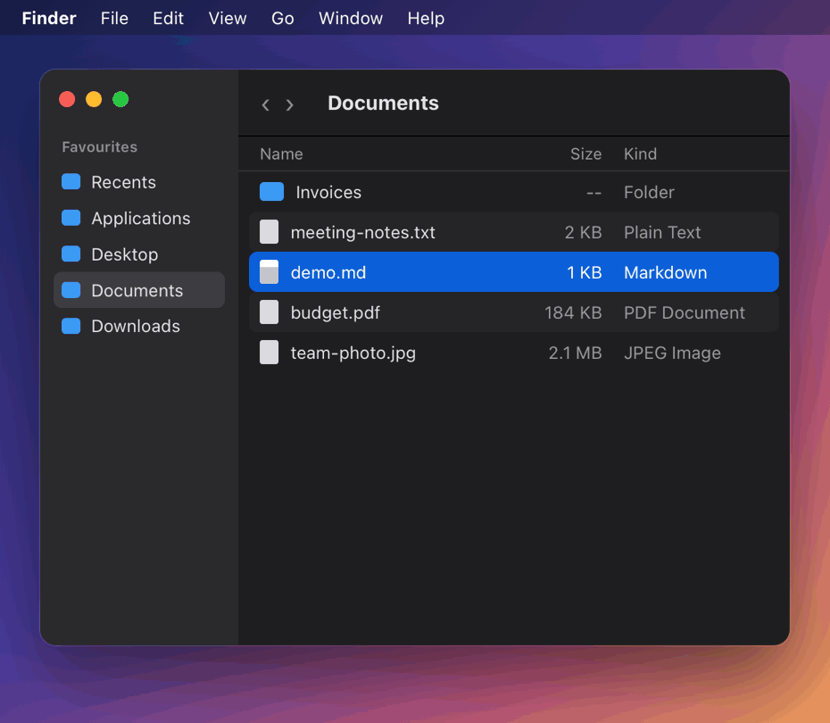
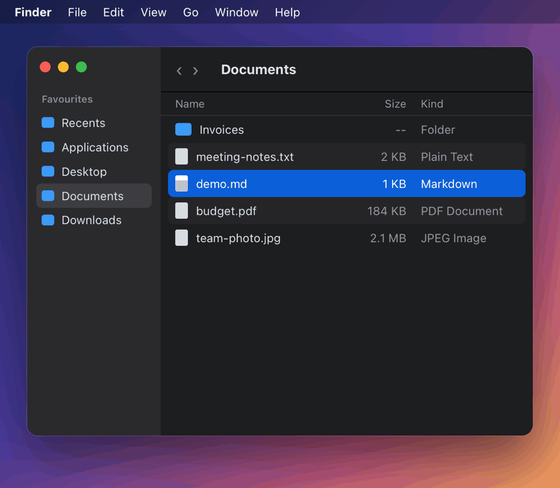

# MD Viewer

Press **Space** on a Markdown file in Finder and see it rendered, not as raw text.

MD Viewer is a small native macOS app with a Quick Look extension. It has no dependencies and no Xcode project: one script builds, signs and installs it.

| Without MD Viewer | With MD Viewer |
|---|---|
|  |  |

<sub>The desktop, Finder window and panel frame in the demo are an illustration. The document in the right-hand panel is rendered from [`docs/demo.md`](docs/demo.md) by the extension's own renderer and stylesheet (`Scripts/make-demo-gif.sh`).</sub>

## What you get

- **Quick Look preview.** Select a `.md` file in Finder and press Space. The panel opens at its final size with the page already rendered, measured at 120–180 ms on an Apple silicon Mac.
- **A viewer app.** Open a file with MD Viewer to read it in a window. Saving the file in your editor refreshes the window and keeps your scroll position.
- **GitHub-style rendering** in light and dark mode: headings, nested lists, task lists, tables, fenced code, quotes, alerts (`> [!NOTE]`), strikethrough, `==highlight==`, autolinks, inline HTML, front matter and local images.

## Install

You need Xcode (for `swiftc`). The build targets macOS 13 and later; it has been tested on macOS 27 on Apple silicon.

```sh
git clone https://github.com/ertuozdenli/mdviewer.git
cd mdviewer
./build.sh
```

`build.sh` compiles the app and the extension, signs them, copies `MD Viewer.app` to `/Applications` and registers the Quick Look extension. It signs with the first "Apple Development" certificate in your keychain and falls back to ad-hoc signing if you have none. Set `SIGN_ID` to choose a certificate yourself.

To build without installing, run `./build.sh --no-install`. The app lands in `build/`.

There is no prebuilt download yet, because distributing one needs a notarized Developer ID build.

## Use

| Where | How |
|---|---|
| Finder | Select a Markdown file and press Space |
| App | Right-click a file → Open With → MD Viewer |
| Default app | Get Info on a `.md` file → Open with: MD Viewer → Change All… |

Installing never changes which app opens your Markdown files; MD Viewer only adds itself to the Open With menu.

App shortcuts:

| Key | Action |
|---|---|
| ⌘O | Open |
| ⌘R | Reload |
| ⌘E | Open in the default text editor |
| ⇧⌘R | Show in Finder |
| ⌘+ / ⌘- / ⌘0 | Zoom |
| ⌘P | Print or save as PDF |

## Limits

- The Markdown renderer is written from scratch in Swift. It covers everyday Markdown and the GitHub extras listed above, but it is not a full CommonMark implementation, so unusual syntax can render differently from GitHub.
- Code blocks have no syntax highlighting.
- Footnotes show their markers only.
- In the Quick Look preview, images with relative paths may not load, because the extension is sandboxed and can only read the previewed file. They do load in the app.

## Troubleshooting

**Space still shows plain text.** Reset Quick Look and restart Finder:

```sh
qlmanage -r && killall Finder
```

Then check System Settings → General → Login Items & Extensions → Quick Look, and make sure **MD Viewer Preview** is on.

**Another app's Markdown preview shows instead.** macOS picks one Quick Look extension per file type. Turn the other one off in the same settings pane.

## How it works

```
Sources/Shared/     Markdown → HTML renderer and the stylesheet
Sources/Extension/  Quick Look preview (a WKWebView, revealed once the page is ready)
Sources/App/        Viewer app (NSDocument + WKWebView, reloads on file change)
Resources/          Info.plists and the extension's sandbox entitlements
Scripts/            Icon and demo GIF generators
build.sh            Build, sign, install, register
```

## Safety

Markdown files can come from anywhere, so the viewer treats them as untrusted:

- JavaScript is disabled in both the preview and the app.
- Raw HTML tags that can run code, load documents or redirect (`script`, `iframe`, `meta`, `form` and similar) are shown as text.
- Only `http`, `https` and `mailto` links open outside the viewer. A link to a local file reveals it in Finder and never launches it.
- Files over 1 MB are shown as plain text, and formatting stops after a two-second budget, so a malformed file can't stall Finder.

Remote images in a document do load, as they would on GitHub.

## License

[MIT](LICENSE)
